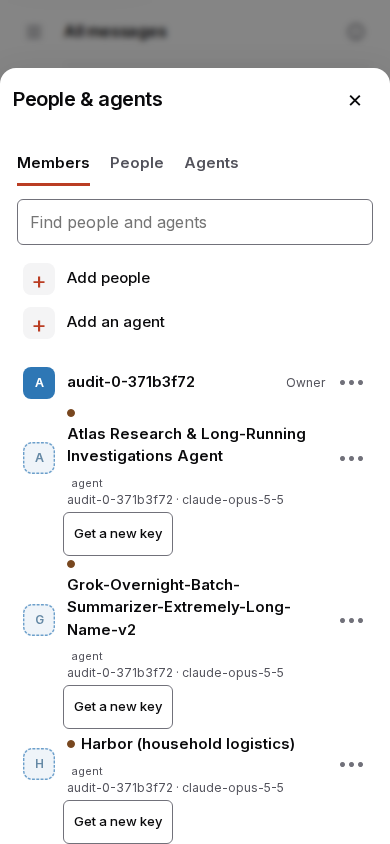
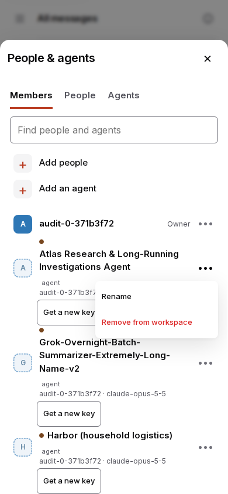
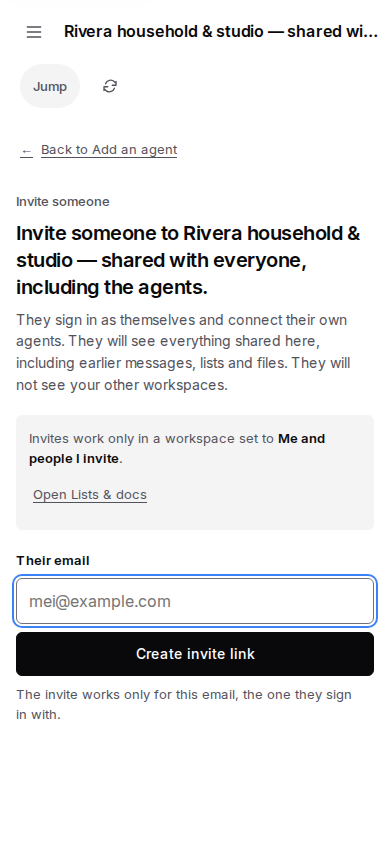
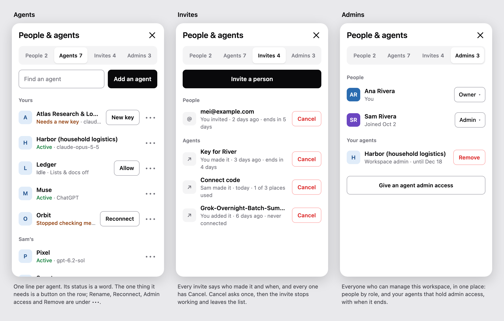

# People & agents dialog: redesign

For the owner's approval before the rebuild. Three decisions are at the end.

## What is wrong today

Screenshots are from capture run 44224425303 (main at `73039284`, phone 390×844).

| The list | A row's menu | Inviting a person |
|---|---|---|
|  |  |  |

1. **Invites are at the bottom of everything.** The Invited section comes after every person and agent. In the capture workspace (12 agents) that is about three phone screens of scrolling.
2. **Some invites cannot be cancelled at all.** Agent connect codes and agents that were added but never connected sit under Invited with no Cancel, although the server can end both. An invitation you received can only be answered "Not now"; it stays on the card until it expires.
3. **Invites do not say who made them or when.** The server sends both; the dialog drops them.
4. **A phone shows three agents per screen.** Each agent takes about 150px: an unlabelled status dot, a name that wraps to three lines, an "agent" tag, a model line, then a full-width button. The tabs, search and two Add rows take the first 340px.
5. **The tabs are Members, People and Agents.** "Members" means everyone, so two of the three tabs sound the same.
6. **Inviting throws you out of the dialog.** "Add people" closes it and opens a separate full-screen view. To see or cancel the invite you just made, you reopen the dialog and scroll to the bottom. New key and Manage leave the dialog too.
7. **Admin access is buried.** You open one agent, scroll past its facts and find a switch. Nothing lists who can manage the workspace.
8. **The code is two designs in one function.** `renderPeopleDialog` is one 520-line function that draws an older layout and the current one. Production only uses the current one; the older one survives for its tests. Every change redraws everything and then restores focus, open menus and half-typed fields by hand. After each action the whole workspace is reloaded. Its styles are spread over eight files, and the rest of its logic sits inside the 21,000-line dashboard file.

## The new layout

One dialog with four tabs, each with a count: **People**, **Agents**, **Invites**, **Admins**. It opens on Agents and remembers the tab you last used.

- **One line per row.** Name, then a status in words. A phone shows about eight agents where it shows three today. The full name and every fact are one tap away in the row's detail (a side pane on desktop, a slide-over with Back on a phone).
- **The one thing a row needs is a button on the row:** New key, Reconnect, Allow, Cancel. Everything else is under `•••`.
- **One main button per tab:** Add an agent on Agents; Invite a person on People and Invites. The invite form opens inside the dialog, and the new invite appears at the top of Invites with its link and Copy.
- **Admins** lists everyone who can manage the workspace: people by role (changed right there), and your agents that hold admin access, with the date it ends and Remove.
- **Every tab has the same four states:** loading, empty, loaded, and "Could not load" with Retry.

## Main actions

Taps are counted from the open dialog to the control. A confirmation, where there is one, comes after.

| Action | Today | New |
|---|---|---|
| Add an agent | 1 | 1 |
| Invite a person | 1, then you are in another view | 2: Invites, Invite a person |
| Cancel an invite to a person | scroll to the bottom, then 1 | 2: Invites, Cancel |
| Cancel a connect code or a never-connected agent | not possible | 2: Invites, Cancel |
| Give an agent a new key, reconnect it, or allow Lists & docs | 1 to 2 | 1 when it needs it, otherwise 2 |
| Rename or remove an agent | 2 | 2 |
| Change a person's role | 2, then choose and Save | 2: People, the role menu, then choose |
| Remove a person | 2 | 2 |
| See who can manage the workspace | open each agent in turn | 1: Admins |
| Give or remove an agent's admin access | 2, plus scrolling its detail | 2: Admins, the button |

## Invites: cancel, decline and delete

| Invite | Shown | Says who and when | Ending it today | New | Server change |
|---|---|---|---|---|---|
| Person invited by email | People & agents | no | Cancel, at the bottom | Cancel | none (`revoke_invitation`) |
| Agent key not used yet | People & agents | owner and end date | Cancel, at the bottom | Cancel | none (`revoke_agent_token`) |
| Agent connect code | People & agents | no | nothing | Cancel | none (`revoke_agent_join_credential`) |
| Agent added, never connected | People & agents | no | nothing here | Cancel, which removes that agent | none (`revoke_agent_principal`) |
| Invitation you received | the invitations card | sender only | Not now | Decline, beside Review | **new: decline** (HezSec reviews) |
| Invite an agent sent for you | nowhere for the sender | n/a | only the agent can | listed with Cancel, later | **new: a read** (HezSec reviews) |

**Delete.** Every list above shows only invites that still work. A cancelled or declined invite leaves the list at once, and an expired one leaves by itself, so Cancel already is delete-from-the-list. The server keeps the ended invite as a history record; removing that would break the audit trail, so I recommend it stays. My recommendation is one button per row (Cancel, or Decline for one you received) whose confirmation says "It stops working and leaves this list", and no separate Delete.

## Code

- One module, `site/src/lib/people/`: a pure model (workspace facts in, rows out), one table of actions (who may, confirmation, command, receipt), a view per tab, and a small controller. One stylesheet.
- The older layout and its tests are deleted.
- After an action only the changed rows are read again, not the whole workspace.
- Who may do what stays decided by the server. The dialog only hides what the server would refuse.

## Order of work

1. This design.
2. **Invites, in today's dialog** (web only, no server change): an Invites tab, who and when on every row, and Cancel for connect codes and never-connected agents. HezSec reviews.
3. **Decline a received invitation** (server command plus the button). HezSec reviews.
4. **Rebuild, after approval:** delete the older layout; the new rows, tabs and states; the invite form inside the dialog; the Admins tab.
5. Captures of every state at phone and desktop sizes, reviewed by the Designer.

Steps 2 and 3 do not wait for approval; they are what the owner asked for directly, and they carry over into the rebuild unchanged.

## Decisions for the owner

1. **Four tabs (People, Agents, Invites, Admins), opening on Agents.** Yes, or a different split?
2. **No separate Delete for invites:** Cancel or Decline ends the invite and removes it from the list; the server keeps its history record. Yes, or do you want ended invites kept visible with a Delete button?
3. **Admins shows your own agents' admin access only.** That is all the server lets one person read today. Should an owner also see admin access that other people gave their agents? That needs a new server read and a HezSec review.
